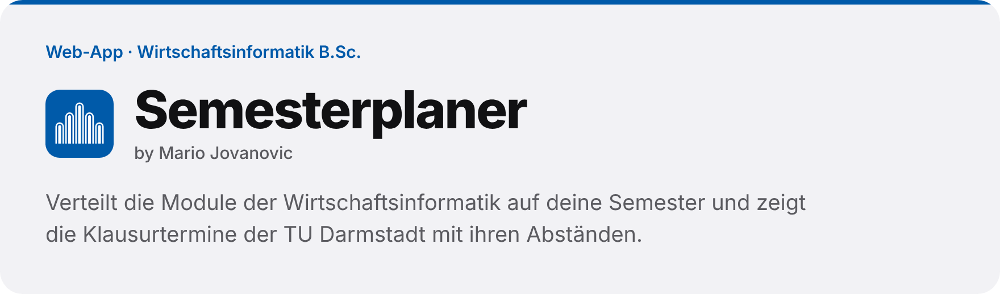
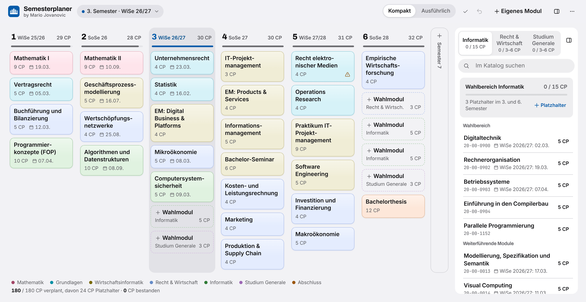
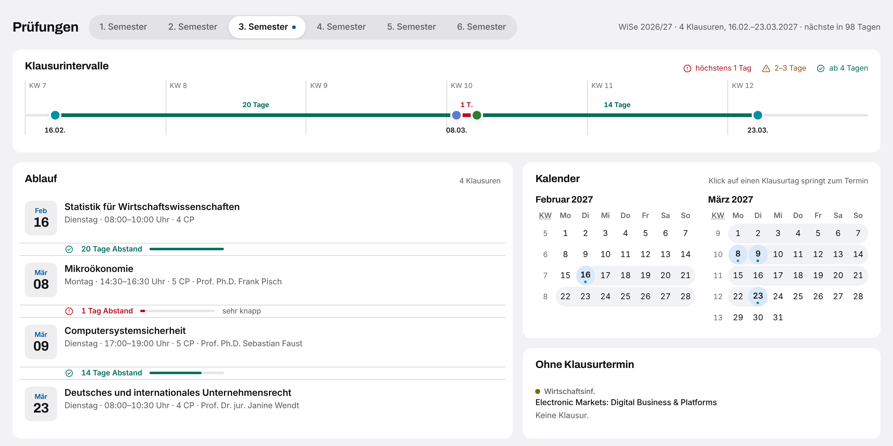
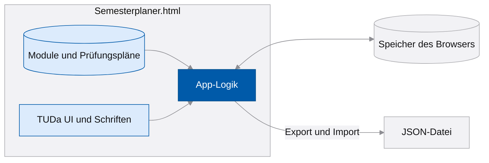

<picture>
  <source media="(prefers-color-scheme: dark)" srcset=".github/assets/banner-dark.png">
  
</picture>

<p>
  
  <a href="https://github.com/MarioJovc/semesterplaner/actions/workflows/pages.yml"></a>
  
</p>

Ein Planer für den Bachelor Wirtschaftsinformatik an der TU Darmstadt. Du verteilst die Module auf deine Semester, siehst zu jedem Semester die Klausurtermine mit ihren Abständen und behältst die Credit Points im Blick. Die ganze App steckt in einer HTML-Datei: Sie läuft im Browser, ohne Anmeldung und ohne Server, und speichert nur auf deinem Gerät.

**Projektseite:** [mariojovc.github.io/semesterplaner](https://mariojovc.github.io/semesterplaner/) · **App:** [im Browser öffnen](https://mariojovc.github.io/semesterplaner/app/)

<picture>
  <source media="(prefers-color-scheme: dark)" srcset="docs/assets/plan-dunkel.png">
  
</picture>

## Funktionen

- **Semesterplan:** startet mit dem Studienplan aus der Modulübersicht; Module verschiebst du per Drag & Drop mit Maus, Stift oder Finger oder im Moduldetail
- **Urlaubssemester, Praktikum und Ausland:** ein Klick auf die Semesternummer legt die Art des Semesters und eine Notiz fest; ein leeres Semester fügst du davor oder danach ein, spätere Module rücken nach. Urlaubssemester zählen nicht als Fachsemester
- **Modulkatalog** für die Wahlbereiche Informatik, Recht und Wirtschaft sowie Studium Generale, mit Platzhaltern und eigenen Modulen
- **Prüfungen je Semester:** Ablauf, Zeitstrahl der Abstände und Kalender; Abstände von höchstens einem Tag und von zwei bis drei Tagen sind markiert
- **Prüfungsplan der ganzen TU** durchsuchen, etwa für Studium Generale, und Treffer als eigenes Modul übernehmen
- **Status je Modul:** geplant, angemeldet oder bestanden, dazu die Fehlversuche und der Stand deiner Credit Points
- **Rückgängig mit Strg+Z**, Export und Import als JSON, helles und dunkles Design

## Schnellstart

Online musst du nichts installieren: [App öffnen](https://mariojovc.github.io/semesterplaner/app/). Dein Plan bleibt im Speicher dieses Browsers.

Ohne Internet: Lade [`Semesterplaner.html`](Semesterplaner.html) herunter (auf der Dateiseite oben rechts „Download raw file“ oder auf der Projektseite „Herunterladen“) und öffne die Datei in deinem Browser.

## Nutzung

1. Stell oben links dein aktuelles Semester und deinen Studienbeginn ein.
2. Zieh Module in andere Semester oder öffne ein Modul und wähle „Geplant im“. Wahlmodule holst du aus dem Katalog rechts in die Platzhalter.
3. Für ein Urlaubssemester, ein Praktikum oder ein Auslandssemester klickst du auf die Nummer des Semesters. Dort legst du die Art fest und fügst bei Bedarf ein leeres Semester ein; alle späteren Module rücken dann ein Semester nach hinten.
4. Markiere Module als angemeldet oder bestanden. Unter „Prüfungen“ siehst du für jedes Semester, wann deine Klausuren liegen und wie viel Zeit dazwischen bleibt.

<picture>
  <source media="(prefers-color-scheme: dark)" srcset="docs/assets/pruefungen-dunkel.png">
  
</picture>

Um auf einem anderen Gerät weiterzuplanen, exportierst du den Plan über das Menü oben rechts und importierst die JSON-Datei dort wieder.

## So funktioniert's



Alles, was die App braucht, steckt in der einen Datei: die Daten aus Modulübersicht und Prüfungsplänen, das Designsystem TUDa UI mit seinen Schriften und die App-Logik in JavaScript. Sie stellt keine Anfragen ins Netz, und dein Plan liegt im `localStorage` deines Browsers. Im Code stehen außerdem ein Planer-Assistent und eine Speicherung im Konto; beide laufen nur, wenn die Datei als Claude-Artifact geöffnet wird, und bleiben sonst ausgeblendet.

## Daten und Stand

| Quelle | Stand |
|---|---|
| Modulübersicht Wirtschaftsinformatik (Satzungsbeilage 2020_I) | 23.08.2024 |
| Modulhandbuch | 01.10.2024 |
| Prüfungspläne der TU Darmstadt | WiSe 2025/26, SoSe 2026, WiSe 2026/27 |

Angaben ohne Gewähr. Verbindlich sind TUCaN, die Prüfungsordnung und das Modulhandbuch; Termine können sich nach dem Stand der Prüfungspläne noch verschieben.

## Projektstruktur

```text
semesterplaner/
├── Semesterplaner.html   die App: Daten, TUDa UI, Schriften und Logik in einer Datei
├── docs/                 Projektseite mit Screenshots (GitHub Pages)
├── lizenzen/             Lizenztexte der eingebetteten Schriften
└── .github/workflows/    Workflow „Pages“: veröffentlicht Projektseite und App
```

## Entwicklung

| Aufgabe | So geht's |
|---|---|
| App ausprobieren | `Semesterplaner.html` im Browser öffnen |
| Über einen lokalen Server | `python -m http.server 8000`, dann `http://localhost:8000/Semesterplaner.html` |
| Veröffentlichen | Push auf `main`; der Workflow „Pages“ stellt die Projektseite unter `/` und die App unter `/app/` bereit |

Die Daten stehen am Anfang des zweiten `<script>`-Blocks: `PLANS` enthält die Prüfungspläne je Semester (`WS2026` steht für das Wintersemester 2026/27), `MODULES`, `CATALOG` und `DEFAULT_PLAN` beschreiben Module, Wahlbereiche und den Studienplan. Der Workflow bricht ab, wenn die Datei externe Skripte, Stylesheets oder Bilder einbindet.

## Mitwirken

Fehler und Ideen gern als [Issue](https://github.com/MarioJovc/semesterplaner/issues/new/choose), auch wenn ein Termin oder ein Modul nicht mehr stimmt. Lade dabei bitte keinen exportierten Plan mit deinem Studienstand hoch.

## Lizenz

Der Code steht unter der [MIT-Lizenz](LICENSE). Die Modul- und Termindaten stammen aus Veröffentlichungen der TU Darmstadt. Die eingebetteten Schriften Archivo und JetBrains Mono stehen unter der SIL Open Font License 1.1; die Lizenztexte liegen in [`lizenzen/`](lizenzen).

<br>

<p>
  
  <sub><b>Semesterplaner</b> · by Mario Jovanovic<br>Inoffiziell, kein Angebot der TU Darmstadt</sub>
</p>
